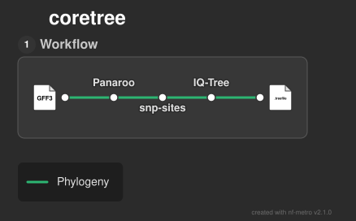

# coretree

Simple prokaryotic core genome phylogeny workflow written in Nextflow



## Workflow

1. Create a core genome alignment with [panaroo](https://github.com/gtonkinhill/panaroo)
2. Extract core SNPs with [snp-sites](https://github.com/sanger-pathogens/snp-sites)
3. Build the tree with [IQ-TREE](https://iqtree.github.io/)

## Setup

1. First ensure you have [Nextflow](https://docs.seqera.io/nextflow/install#installation) installed
2. Next ensure you have either [Docker](https://docs.docker.com/engine/install/) or [Singularity](https://docs.sylabs.io/guides/3.0/user-guide/) installed
3. Clone the repo with ``git clone https://github.com/tmorr-12/coretree``

## Usage

**coretree** takes only one input, the path to a directory containing gff3 files:

```
nextflow run main.nf --gffs <path/to/gffs_dir> -profile <standard|laptop>
```

The standard profile is designed for use on the CGR cluster. If you are running the pipeline on your local machine, please use the 'laptop' profile, otherwise your device may spontaneously combust.

## Output

By default results are saved in the results directory created when you launch the pipeline. `core_tree.treefile` contains the final tree in Newick format, with the `core_gene_alignment.aln` containing the entire core genome alignment, and `core_snps.phylip` containing all core SNPs found with snp-sites.

```
results
├── core_gene_alignment.aln
├── core_snps.phylip
├── core_tree.treefile
└── pipeline-info
    ├── execution_trace_20261104_145058.txt
    ├── pipeline_dag.mmd
    └── software_versions.tsv
```